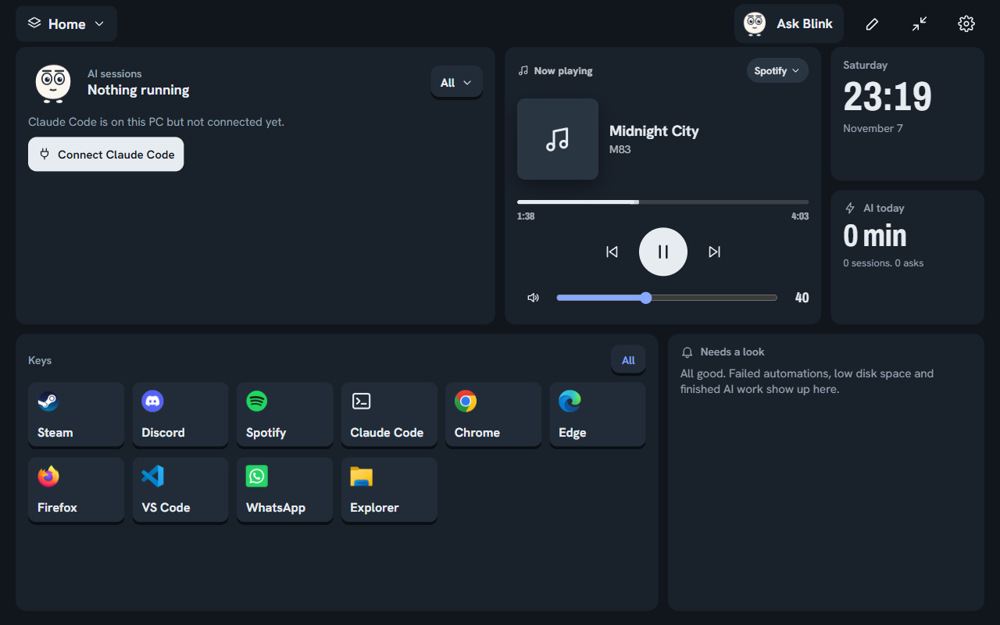
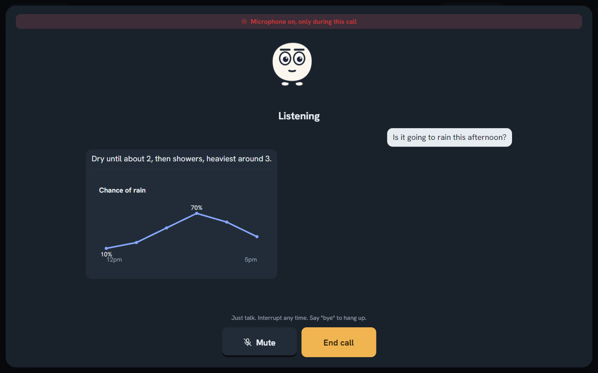
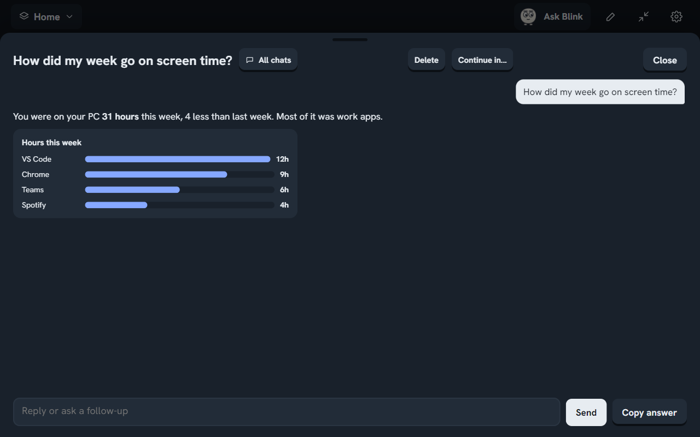
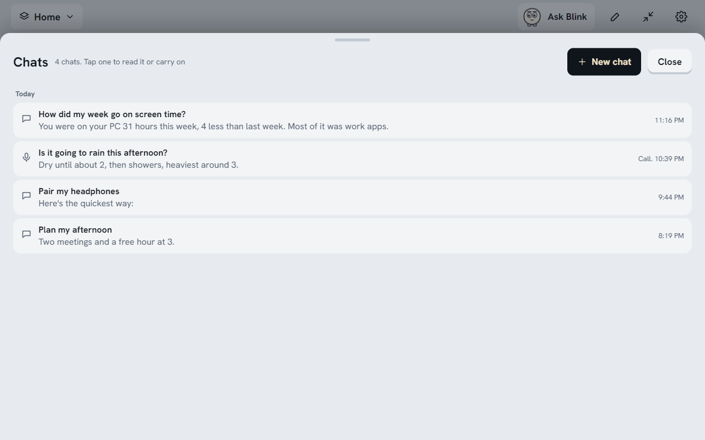

<div align="center">

# Side Panel

**A calm control screen for the second monitor on your desk, with Blink, a voice assistant you can just talk to.**

Music, meetings, your apps, your AI sessions and a hands-free assistant, all on one touch-friendly screen beside your main monitor.
Free. Private. No accounts. No admin rights needed.

[**Download for Windows**](https://github.com/SalmanAlbalooshi/side-panel/releases/latest) · [What it does](#what-it-does) · [Install](#install) · [Privacy](#privacy)



</div>

---

## Why

Your main screen is for work. Everything else (the song that's playing, the meeting in ten minutes, the app you keep reopening, the AI task running in the background) keeps pulling you away from it. Side Panel puts all of that on a small second screen, a spare monitor or a tablet-sized touch display, so you can glance, tap and get back to work.

And when you'd rather not type, you talk to **Blink**.

## Meet Blink



Tap the mic and just talk, like a phone call:

- **Interrupt any time.** Blink stops mid-sentence when you speak, and ignores its own voice coming back through your speakers.
- **Short answers out loud, details on screen.** A list, steps or a chart shows on the panel while Blink says the short version.
- **It does things.** "Play Midnight City", "mute me on Teams", "put Spotify on the left and Chrome on the right", "find the PDF I downloaded yesterday", "remind me in 10 minutes to stretch".
- **It hands real work to your AI.** If you use Claude Code, Blink is its friendly face: quick questions it answers itself, bigger jobs go to your full Claude Code setup (your agents, skills and tools) in the background, and Blink tells you when they're done.
- **It remembers.** Tell Blink "remember I prefer metric units" and your Claude Code knows it too.
- **Mute** when someone walks in, **Stop** if it's taking too long, say **"bye"** to hang up.

## What it does

| | |
|---|---|
| **Music** | Now playing for any app (Spotify, YouTube Music, Apple Music, your browser): play, skip, seek, volume, lyrics. "Play &lt;song&gt;" goes to the music app you pick, no sign-in needed. |
| **Keys** | One-tap buttons for apps, folders, websites, people (Teams chat, call, email, WhatsApp), shortcuts, text snippets, and actions inside your apps (Teams mute and raise hand, Discord deafen, Steam downloads, Zoom join, Windows settings). |
| **Meetings** | Your next Outlook meeting with a Join button, and quiet mode while you're in one. |
| **AI sessions** | See your Claude Code and Codex sessions at a glance: what's running, what's waiting for your OK, what finished. Approve from the panel. |
| **Chats** | Every chat and call with Blink is kept, searchable, and can continue in the Claude app. |
| **Visuals** | Answers can include simple cards: a big number, bars, a line chart, a progress ring, steps or a timeline. |
| **Layouts** | Home, Work and Gaming screens that switch by themselves (a game starts, work hours begin) or with a tap. A Mini mode for a normal monitor. |
| **Routines** | "When I start a game, do not disturb for an hour and set volume to 40." |
| **Arabic** | Talk or type in Arabic; Blink answers in Arabic. |

<p>


</p>

## Install

**No admin rights needed.** It installs just for you, in your own user folder, so it works on locked-down work PCs too.

1. Go to [**Releases**](https://github.com/SalmanAlbalooshi/side-panel/releases/latest) and download `Side-Panel-<version>-win32-x64.zip`.
2. Unzip it anywhere (your Downloads folder is fine).
3. Double-click **`Install.cmd`**. Side Panel is copied to your user folder, gets a Start menu and desktop shortcut, and opens.

Or skip installing: unzip and double-click **`Side Panel.exe`**.

> **"Windows protected your PC"?** The app isn't code-signed yet, so Windows warns the first time. Click **More info**, then **Run anyway**. Some company PCs block unsigned apps by policy; if so, your IT team needs to allow it.

**Updates are one click.** Side Panel checks this page for new versions. When one is out you get a small pop-up (and an Update button in Settings): tap **Update now** and it downloads, checks the file's fingerprint, swaps itself in and restarts. Still no admin rights.

### What you need

- Windows 10 or 11.
- Optional, for AI answers: [Claude Code](https://claude.com/claude-code) or Codex installed and signed in. Without them, everything that runs on your PC (music, keys, meetings, files, app actions, voice commands) still works, and Blink offers to open an AI in your browser for questions.
- Optional: a second screen. It also runs as a small always-on-top Mini panel on a single monitor.

## Privacy

- **Everything runs on your PC.** No accounts, no servers, no tracking.
- **Speech stays local.** Hearing and the voice run on your PC (open-source models, downloaded once the first time you use them). Nothing you say is sent anywhere except the words you ask the AI about, which go to the AI you already use.
- **The microphone is only on during a call,** with a red bar on screen the whole time.
- **Blink asks first** before it uses an app for the first time, and before it sends, deletes, buys or posts anything. It never types passwords or card numbers, and it treats text from web pages and apps as information, never as instructions.

## Build from source

```
git clone https://github.com/SalmanAlbalooshi/side-panel
cd side-panel
npm install
npm run helper     # builds the small Windows helper (needs the .NET 10 SDK)
npm start          # runs it
npm run package    # makes release/Side Panel-win32-x64
npm run release    # makes the zip and checksum file for a GitHub release
```

The app is Electron (plain HTML, CSS and JavaScript, no framework) plus a small .NET helper for Windows media controls, volume, app control and the voice engine. Tests use Playwright: `node test/assistant.js` and the other files in `test/`.

## Built with AI

Side Panel was designed and directed by a person and **built with AI assistance (Claude Code)**: most of the code, tests and these docs were written by AI under human direction, review and testing. Issues and pull requests are welcome.

## Credits

Speech runs on [sherpa-onnx](https://github.com/k2-fsa/sherpa-onnx) (Apache 2.0). Voices and hearing models are downloaded on first use: [Kokoro](https://huggingface.co/hexgrad/Kokoro-82M) (Apache 2.0), [Piper](https://github.com/rhasspy/piper) voices, [Moonshine](https://github.com/usefulsensors/moonshine) (MIT) and [NVIDIA Parakeet](https://huggingface.co/nvidia/parakeet-tdt-0.6b-v2) (CC BY 4.0). Speech detection uses [Silero VAD](https://github.com/snakers4/silero-vad) (MIT) through [vad-web](https://github.com/ricky0123/vad) (ISC).

## License

[MIT](LICENSE). Free to use, change and share.
